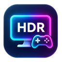
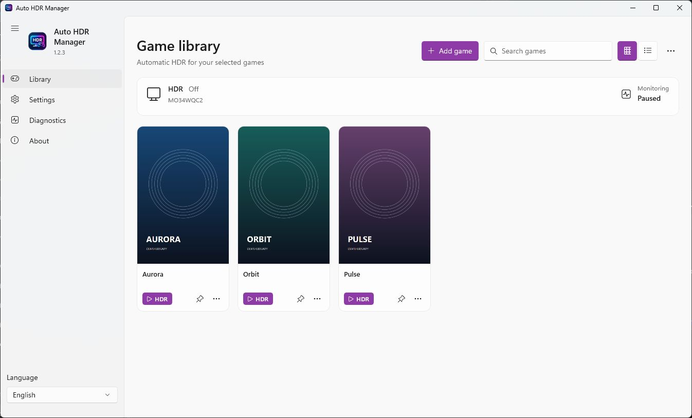
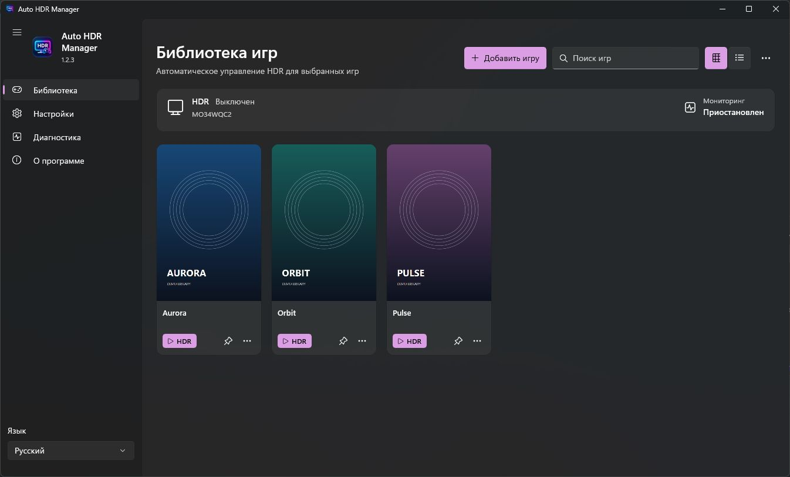
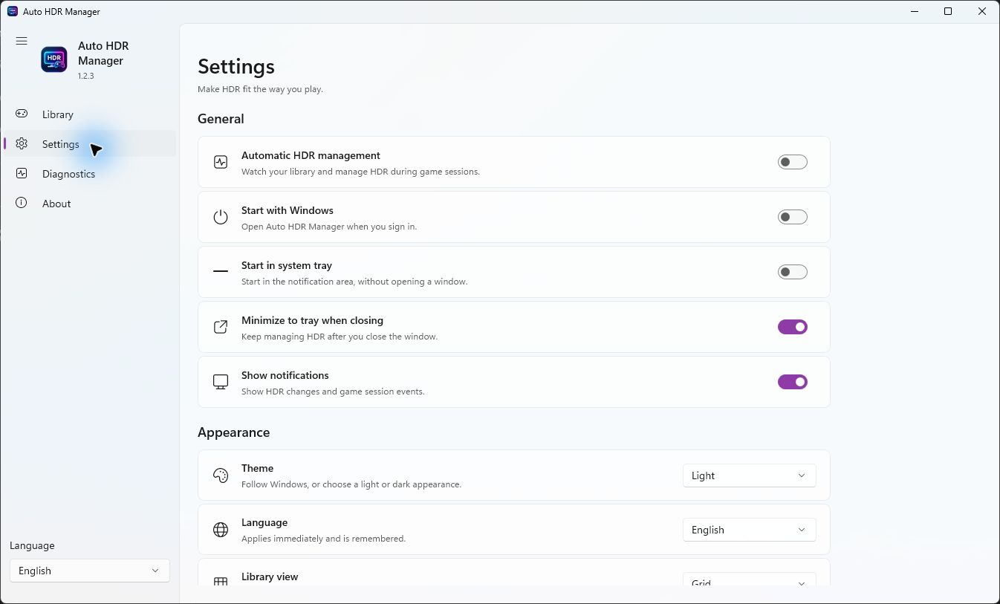

English · [Русский](README.ru.md)



# Auto HDR Manager

Automatically enable Windows 11 HDR before launching your games and restore the previous display state when they exit.

**[Download v1.2.3](https://github.com/grishgun/AutoHDRManager/releases/tag/v1.2.3)** · [Release notes](docs/PUBLIC-RELEASE-1.2.3.md) · [Report an issue](https://github.com/grishgun/AutoHDRManager/issues)

## What it does

Auto HDR Manager controls **system Windows HDR**. It does not convert SDR games into HDR or replace Windows Auto HDR. Launch a game from the library or a dedicated HDR shortcut: the manager enables HDR, confirms Enabled + Active, waits one second for stabilization, rechecks the state and starts the existing game launcher. One shared engine tracks the actual game processes and restores the initial state after the last tracked game exits, subject to session ownership and manual override rules.

- Native WinUI 3 interface, Mica, adaptive navigation, portrait cards, search and list view.
- English, Russian and System language; System, Light and Dark themes.
- Single instance with IPC, tray operation and optional Windows startup.
- Per-game HDR shortcuts with the game's original EXE icon and manual Windows taskbar pinning.
- Local PNG/JPG/WEBP covers; optional SteamGridDB integration with your own API key.
- Read-only HDR and taskbar grouping diagnostics.

**Automatic keyless cover downloads are not implemented in 1.2.3.** Games without a chosen cover use an icon placeholder. HDR shortcuts may remain separate from running game windows on the taskbar.

## Screenshots

Actual **1.2.3** Release GUI, isolated safe profile, fictional games and original abstract demo artwork. No commercial game covers or personal library data are included. Monitoring is paused in these screenshots because safe mode forbids HDR writes.





## Requirements

- Windows 11 **x64**, HDR-capable display, compatible graphics driver and connection.
- Target minimum Windows build 22000; development validation used build 26300. Other hardware/build combinations require validation.
- The self-contained EXE bundles .NET and Windows App SDK. No administrator rights, MSIX package or separate .NET installation is required by this build.
- A clean Windows VM and broad multi-monitor matrix have **not** been validated. The executable is unsigned; verify its checksum and source before running it.

## Download and run

1. Read and accept the [portable binary and third-party terms](BINARY-TERMS.md).
2. From [Release v1.2.3](https://github.com/grishgun/AutoHDRManager/releases/tag/v1.2.3), download **AutoHDRManager.exe** and **SHA256SUMS.txt** into the same folder.
3. Verify the checksum in PowerShell:

   ```powershell
   (Get-FileHash .\AutoHDRManager.exe -Algorithm SHA256).Hash
   Get-Content .\SHA256SUMS.txt
   ```

   The hexadecimal values must match.
4. Put the EXE in a stable folder and run it. For an update, exit the previous manager through its tray menu before replacing the file.

The single EXE extracts bundled runtime/assets into the normal .NET bundle cache. Settings, library, covers and logs are stored in `%LOCALAPPDATA%\AutoHDRManager`; shortcut infrastructure uses `%APPDATA%\AutoHDRManager`. Closing the window normally hides it in the tray. Use **Exit** in the tray or the library's `···` menu to stop the manager.

## Add and launch a game

Click **Add game** and select the actual game EXE, or choose a running process from an empty library. In the game's `···` menu, **Game settings** configures the name, tracked executable, launch method and arguments. Supported launch methods are a direct EXE, a custom executable command or a platform URI. Track the real game process rather than only a launcher.

Click the card's **HDR** button to prepare HDR and launch the game. If HDR cannot be confirmed, launch is stopped and an error is reported. Independently launched games may initialize graphics before background monitoring can enable HDR; use the HDR launch entry for pre-launch ordering.

To set a cover, use `···` → **Change cover**. PNG, JPG and WEBP are decoded and cached locally. SteamGridDB is optional and disabled by default; enabling it requires your own key in Settings. No Steam account or client is required for local game entries or local covers.

## Pin an HDR launch to the taskbar

1. Choose **Pin HDR launch to taskbar** in the game menu.
2. The manager creates/reuses a standard `.lnk` and selects it in File Explorer.
3. Right-click the link and choose **Pin to taskbar**, possibly under **Show more options**.

The app reports shortcut creation, not confirmed pinning. Clicking the pinned shortcut forwards `--launch-game <GameId>` through IPC to the existing manager, or starts one in the background. There is no second monitoring engine. After moving the portable EXE, run the new copy once to refresh the stable launcher; existing links retain their targets. Original Steam shortcuts and Windows' pinned-item database are not edited.

Windows Shell controls grouping. The HDR shortcut and the game's own window **can appear as two taskbar buttons**; 1.2.3 does not guarantee merging them. [Taskbar behavior and diagnostics](docs/TASKBAR.md).

## Language and settings

The language picker is at the bottom of the expanded navigation pane and in Settings. **System** uses Russian for Russian Windows locales and English otherwise. Language, theme and grid/list changes apply immediately and persist. General/HDR settings use **Save**. Presentation changes do not restart the HDR engine or interrupt a session.

Settings include startup, start minimized, close to tray, notifications, monitoring, display selection, enable/restore delays and optional covers. To preserve your existing configuration, replace only the EXE during an update.

## Troubleshooting and limitations

- **HDR unavailable:** use Diagnostics to read the active displays; check Windows HDR support, connection and driver. No guaranteed compatibility across all displays/GPUs is claimed.
- **Game not tracked:** configure its actual executable, including a child shipping process if necessary. Launcher and tracked EXE may differ.
- **HDR changed manually:** the manager yields ownership and avoids blindly undoing the manual change. A disconnected display also ends ownership; restoration failures retain recovery information.
- **No cover:** choose a local image. There is no automatic keyless online lookup in this version.
- **Two taskbar buttons:** a known Windows Shell/launcher limitation; use read-only grouping diagnostics, not injected window changes.
- **Report a bug:** use [Issues](https://github.com/grishgun/AutoHDRManager/issues). Logs and taskbar reports can contain private paths; redact them first. See [SECURITY.md](SECURITY.md) for private security reports.

There is no automatic updater. System/driver changes between the final HDR read and process startup cannot be eliminated. [Compatibility details](docs/HDR-COMPATIBILITY.md).

## Build and tests

On Windows x64, install the .NET SDK specified in `global.json`, then run:

```powershell
./scripts/build-release.ps1
```

Output: `dist/AutoHDRManager.exe`. The script runs Core and Windows tests and verifies a single-file publish. `-Headless` skips only the physical-display read test for CI; it does not switch HDR. **86 tests passed** locally for this release (63 Core + 23 Windows, no skips). GitHub Actions builds and uploads artifacts; it does not publish releases automatically. [Build details](docs/BUILD-ENVIRONMENT.md) · [Architecture](docs/ARCHITECTURE.md) · [Contributing](CONTRIBUTING.md).

Windows Server GitHub Actions also uses `-WithoutWebpCodec` because its system WEBP decoder fails to initialize (0x88982F8B). CI runs 84 cases with two explicit exclusions: physical-display reading and one WEBP integration case. All 86 passed locally before release. Application WEBP support depends on an installed working Windows system decoder; PNG/JPG remain available.

## License

Original project code, documentation, logo and original demo artwork: **[MIT](LICENSE)**, copyright (c) 2026 grishgun. Bundled dependencies retain their own licenses; see [THIRD-PARTY-NOTICES.md](THIRD-PARTY-NOTICES.md) and [BINARY-TERMS.md](BINARY-TERMS.md). This project is not affiliated with Microsoft, Valve or any game publisher.
