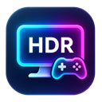
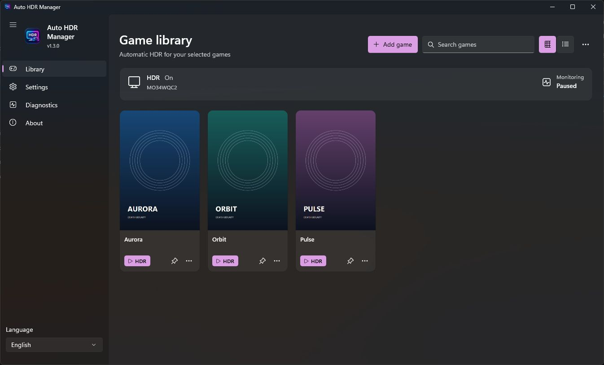

**[English](README.md) | [Русский](README.ru.md)**

# Auto HDR Manager

**Auto HDR Manager автоматически включает HDR в Windows для выбранных игр и HDR10/HLG-фильмов, а после завершения возвращает исходный режим экрана.**

**[Скачать последнюю версию — Download Latest Release](https://github.com/grishgun/AutoHDRManager/releases/latest)** · [Все релизы](https://github.com/grishgun/AutoHDRManager/releases) · [Что нового в v1.3.0](docs/V1.3.0-RELEASE-NOTES.md) · [Сообщить об ошибке](https://github.com/grishgun/AutoHDRManager/issues)

Бесплатная portable-программа с открытым исходным кодом для Windows 11. Она управляет **системным HDR**, не преобразует SDR-контент в HDR и не заменяет игровую функцию Windows **Auto HDR**.

## Игры и повседневное использование

- Включение HDR до запуска игры из библиотеки или специального HDR-ярлыка: подтверждение состояния и одна секунда стабилизации перед стартом.
- Восстановление исходного режима после завершения отслеживаемых игр и управляемых HDR-видео. Если HDR был включён изначально, он останется включённым.
- Приоритет ручных изменений HDR и сохранение защиты при переподключении дисплея, введённой в v1.2.4.
- Запуск с панели задач через ярлыки с оригинальными значками игр; работа в трее, один экземпляр программы и необязательный автозапуск Windows.
- Библиотека с поиском, сеткой и списком, локальными обложками PNG/JPG/WEBP и необязательным SteamGridDB с собственным API-ключом.
- Русский и английский интерфейс, системная/светлая/тёмная темы, диагностика HDR и группировки значков панели задач.

**v1.3.0 добавляет Smart Video HDR**, ненавязчивый номер версии и привычные значки VLC. Запуск игр и проверенный HDR-движок сохранены.

## Скриншоты

Настоящие окна v1.3.0 из изолированного безопасного профиля с вымышленными играми и оригинальными демонстрационными обложками. Мониторинг приостановлен, поскольку профиль запрещает переключение HDR. Личная библиотека и чужие игровые обложки не публикуются.

## Требования

- Windows 11 **x64**, HDR-монитор, совместимые GPU/драйвер и подключение дисплея. Минимальная целевая сборка — 22000; пользовательская приёмка выполнена на сборке 26300 / Gigabyte MO34WQC2.
- Для Smart Video HDR нужен установленный или выбранный в настройках **VLC**. Для игр VLC не требуется.
- Не нужно отдельно устанавливать .NET SDK/runtime, Windows App SDK, FFmpeg или MediaInfo: необходимые компоненты и анализатор метаданных встроены в portable EXE.
- Для WEBP-обложек необходим работающий системный декодер Windows; также поддерживаются PNG/JPG.
- EXE не подписан цифровой подписью. Перед запуском проверьте SHA-256. Одинаковая совместимость и качество HDR на всех GPU, мониторах, драйверах и версиях VLC не гарантируются.

## Скачать и запустить

1. Ознакомьтесь с [условиями portable-сборки и сторонних компонентов](BINARY-TERMS.md).
2. Скачайте **AutoHDRManager.exe** и **SHA256SUMS.txt** из [последнего релиза](https://github.com/grishgun/AutoHDRManager/releases/latest).
3. Сравните контрольные суммы в PowerShell:

       (Get-FileHash .\AutoHDRManager.exe -Algorithm SHA256).Hash
       Get-Content .\SHA256SUMS.txt

4. Поместите EXE в удобную папку и откройте его. Установщик и права администратора не нужны.

Закрытие окна обычно оставляет менеджер в трее. Для завершения выберите **Выход**. Настройки, библиотека, обложки и журналы находятся в %LOCALAPPDATA%\AutoHDRManager; служебные файлы ярлыков и обработчика — в %APPDATA%\AutoHDRManager. Встроенные компоненты распаковываются в обычный кеш .NET.

## Добавить и запустить HDR-игру

Нажмите **Добавить игру** и выберите фактический игровой EXE. В меню **Настройки игры** при необходимости задайте отдельный лаунчер или аргументы запуска. Отслеживаться должен настоящий игровой процесс, а не только его лаунчер.

Нажмите **HDR** на карточке. Если включение HDR не подтверждено, игра не запускается и появляется ошибка. Доступно и фоновое обнаружение, но игра, открытая другим способом, может инициализировать графику раньше включения HDR мониторингом. Для правильного порядка используйте специальный HDR-запуск.

Выбирайте локальные PNG/JPG/WEBP через **Изменить обложку** в меню игры. SteamGridDB необязателен, выключен по умолчанию и требует собственного ключа. Автоматическая загрузка обложек без API-ключей не реализована.

### HDR-ярлыки на панели задач

1. Выберите **Закрепить HDR-запуск на панели задач** в меню игры.
2. Менеджер создаст обычный ярлык и откроет его расположение в Проводнике.
3. Нажмите по нему правой кнопкой и выберите **Закрепить на панели задач**; иногда пункт находится в **Показать дополнительные параметры**.

Приложение подтверждает создание ярлыка, а не закрепление средствами Windows. Ярлык обращается к работающему менеджеру или запускает его в фоне. Оригинальные Steam-ярлыки не изменяются.

Windows может показывать HDR-ярлык и запущенную игру **двумя отдельными кнопками**. Объединение не гарантируется. [Подробности о панели задач](docs/TASKBAR.md).

## Автоматический HDR для видео — Smart Video HDR

Smart Video HDR **выключен по умолчанию**. Для открытия фильмов обычным двойным кликом:

1. Установите VLC и убедитесь, что менеджер его обнаружил, либо выберите исполняемый файл в настройках.
2. В разделе **Video HDR** включите **Smart Video HDR**. Автоматическое управление HDR также должно оставаться включённым.
3. Нажмите **Настроить открытие MKV/MP4**.
4. В приложениях по умолчанию Windows 11 выберите **Auto HDR Manager Video** для нужных расширений: MKV, MP4 или обоих.
5. Открывайте фильмы обычным двойным кликом в Проводнике.
6. После просмотра **полностью закройте управляемое окно/процесс VLC**, чтобы менеджер мог восстановить исходный HDR.

HDR10 и HLG определяются автоматически. HDR включается и подтверждается до запуска VLC; SDR-видео его не включает. Игры и HDR-видео используют общую сессию: завершение одного не восстанавливает исходный режим, пока он нужен другому. Ручные изменения HDR имеют приоритет.

**Специальной поддержки Dolby Vision нет.** Файл с явно совместимым базовым слоем HDR10/HLG может использовать этот слой; Dolby Vision без него или неоднозначные метаданные не вызывают включение HDR. При неизвестных метаданных или ошибке подготовки HDR фильм открывается обычным способом в VLC с текущим состоянием экрана.

MediaInfo встроена: отдельные программы анализа метаданных не требуются. При наличии VLC сохраняются его стандартные значки MKV/MP4. Для управляемого видео используется отдельный экземпляр VLC; посторонние окна плеера не перехватываются и не закрываются. Оставляйте менеджер работающим во время просмотра.

Чтобы отменить выбор обработчика, нажмите **Вернуть VLC приложением по умолчанию** либо откройте приложения по умолчанию Windows и назначьте VLC для MKV/MP4. Менеджер не записывает UserChoice напрямую. При отключении Smart Video HDR его обработчик продолжает передавать файлы VLC без переключения HDR, пока вы не выберете другое приложение по умолчанию.

Качество HDR-вывода зависит от VLC, видеодрайвера и дисплея; одинаковый результат на всех системах не гарантируется. [Техническое описание и проверки](docs/SMART-VIDEO-HDR.md).

## Обновление portable-версии

1. Завершите игры и управляемые видео, затем выйдите из старого менеджера через трей.
2. Скачайте и проверьте новый EXE. Замените старый файл или перенесите новую версию в удобную папку.
3. Один раз откройте новый EXE из Проводника: он обновит существующий служебный Launcher и зарегистрированный значок видео; цели игровых ярлыков сохранятся.
4. Сохраните папки данных приложения, чтобы оставить настройки, библиотеку и обложки.

Автообновления нет. Пересоздавать HDR-ярлыки или заново выбирать видеоприложение по умолчанию при каждом обновлении не требуется.

## Язык, устранение ошибок и ограничения

Выберите **English**, **Русский** или **Системный** внизу раскрытой боковой панели либо в настройках. Системный режим использует русский для русской локали Windows и английский для остальных. Язык, тема и сетка/список применяются сразу; другие настройки сохраняются кнопкой **Сохранить**.

- **HDR недоступен:** проверьте дисплей, подключение и драйвер в Windows и разделе диагностики программы.
- **Игра не обнаруживается:** укажите её настоящий EXE, при необходимости — дочерний shipping-процесс.
- **HDR остаётся включённым:** полностью закройте управляемые процессы VLC и отслеживаемые игры. Исходный HDR ON или ручное изменение могут корректно сохранять включённый режим.
- **Монитор отключён:** исходное состояние сохраняется. После завершения последнего процесса ожидание восстановления ограничено 10 минутами / 120 проверками топологии и требует достоверной идентификации дисплея. Неоднозначность или обнаруженное ручное изменение запрещают запись. [Защитные проверки](docs/HDR-RECONNECT-RCA-1.2.4.md).
- **Старый значок видео:** закройте и снова откройте папку Проводника после обновления регистрации менеджером.
- **Сообщение об ошибке:** используйте [Issues](https://github.com/grishgun/AutoHDRManager/issues), предварительно удалив личные пути и данные из журналов. Для сообщений об уязвимостях — [SECURITY.md](SECURITY.md).

## Проверки и разработка

**188/188 локальных автоматических тестов прошли успешно**, включая регрессии владения HDR-сессией и переподключения, совместную работу игр и видео, IPC, ярлыки и декодирование PNG/JPG/WEBP. **17/17 пользовательских проверок прошли** на Windows 11 / MO34WQC2: HDR10, SDR, исходный HDR ON, переподключение, ручное изменение, холодный запуск, игра вместе с VLC, значки и номер версии.

**HLG проверен автоматически, но физическое воспроизведение HLG не подтверждено.** Эти проверки не доказывают совместимость со всеми мониторами, GPU и вариантами переподключения.

Для сборки на Windows установите SDK, указанный в global.json:

    ./scripts/build-release.ps1

Результат — dist/AutoHDRManager.exe. CI использует Windows 11 и x64 SDK, выполняет проверку WEBP без её исключения и проверяет portable-программу при временно недоступных путях установленных SDK на одноразовом runner. В headless CI исключено только чтение физического дисплея; этот тест проходит в полном локальном наборе. CI сохраняет артефакты, но не публикует релизы автоматически.

[GitHub Actions](https://github.com/grishgun/AutoHDRManager/actions) · [Тестирование](docs/TESTING.md) · [Среда сборки](docs/BUILD-ENVIRONMENT.md) · [Архитектура](docs/ARCHITECTURE.md) · [Участие в разработке](CONTRIBUTING.md)

## Лицензия

Оригинальные код, документация, логотип и демонстрационные изображения: **[MIT](LICENSE)**, copyright (c) 2026 grishgun. Встроенные компоненты сохраняют свои лицензии: [Уведомления сторонних компонентов](THIRD-PARTY-NOTICES.md) · [Условия бинарной сборки](BINARY-TERMS.md). VLC не поставляется вместе с программой. Проект не связан с Microsoft, VideoLAN, Valve или издателями игр.
